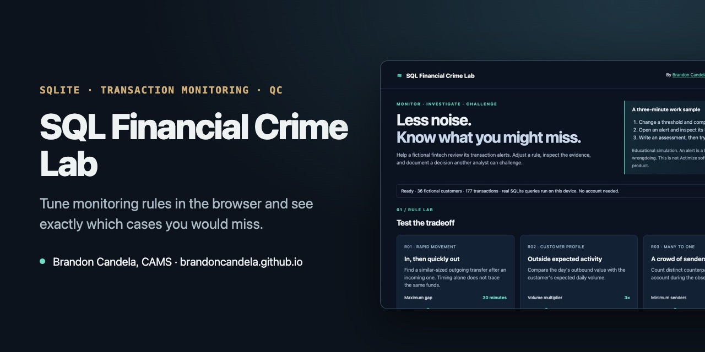

# SQL Financial Crime Lab



**[▶ Open the live demo](https://brandoncandela.github.io/sql-fincrime-lab/)** · [Portfolio](https://brandoncandela.github.io/) · [LinkedIn](https://www.linkedin.com/in/brandon-candela/) · Built by Brandon Candela, CAMS

> **What this shows:** Real SQLite queries (joins, CTEs, window functions) driving AML rule tuning, with measured precision, recall and missed cases.

A fictional fintech has too many alerts. Which monitoring changes reduce review work, and which remove cases that still deserve investigation? This browser-based lab makes that tradeoff visible using real SQLite queries and clearly labeled synthetic fixtures.

## Three-minute recruiter walkthrough

1. Change the rapid-movement, customer-profile or many-to-one threshold.
2. Compare the alert queue, seeded precision, recall and missed cases against the fixed baseline.
3. Open an alert, inspect customer context, transaction IDs and the exact SQL.
4. Submit a fictional analyst assessment and role-play QC acceptance or rework.
5. Export the saved case with its evidence, thresholds, SQL and review history.

## SQL work samples

- [Schema](dist/schema.sql): relational customer, account, transaction and evaluation tables; constraints and query-driven indexes.
- [Scenario queries](dist/queries.sql): parameterized joins, CTEs, `ROW_NUMBER()`, aggregation and distinct counterparties.
- [Downloadable SQLite database](dist/lab.sqlite): 36 fictional customers and 177 transactions.
- [Deterministic data generator](scripts/build_data.py): reproducible fixture construction.
- [SQL tests](tests/test_queries.py): boundaries, duplicate senders, date isolation, integrity and evaluation counts.
- [Implementation and UAT guide](dist/implementation.md): requirements, data mapping, acceptance checks, training, rollback and production gaps.

All dashboard scenario results are computed by SQLite in the browser through vendored SQL.js. No API keys or account are required. The demo makes no external screening calls. Reviews stay in the current browser's local storage; exported cases are local downloads.

## Evaluation design

One observation day (January 15, 2026), USD only, one account and one evaluation scenario per customer. Twelve customer–scenario pairs are authored review-worthy and 24 are authored benign. The baseline detects 18 pairs: 8 seeded positives and 10 seeded benign cases, missing 4 positives. Precision is 8/18 (44.4%); recall is 8/12 (66.7%). These labels are synthetic test fixtures, not real investigations or proof of crime.

Rapid movement uses timing and similar amounts; it does not establish fund provenance. The many-to-one scenario uses a fixed calendar day, not a rolling window. Tightening thresholds can reduce volume while worsening recall; the lab intentionally demonstrates this failure mode.

## Run and verify

```sh
python3 scripts/build_data.py
python3 -m unittest discover -s tests
node --check dist/app.js
python3 -m http.server 5190 --directory dist
```

Open http://localhost:5190. Python's standard library is sufficient to regenerate data and run SQL tests. Node is needed only for the optional JavaScript syntax check. Static assets are tracked; there is no package installation or backend service.

## Scope and limitations

Independent educational work sample created with AI-assisted development. Not employer-endorsed, not a production compliance system and not an implementation of proprietary NICE Actimize SAM/CDD/WLF/IFM software. Demonstrated concepts do not imply Actimize configuration experience. No real bank/customer data is included. QC is an explicitly local role-play, not authenticated separation of duties or an immutable audit log. Never enter confidential data into the public demo. No claim of measured production efficiency or real-world detection performance.

Code is MIT licensed; vendored SQL.js retains its included license. SQLite data and labels are fictional.
